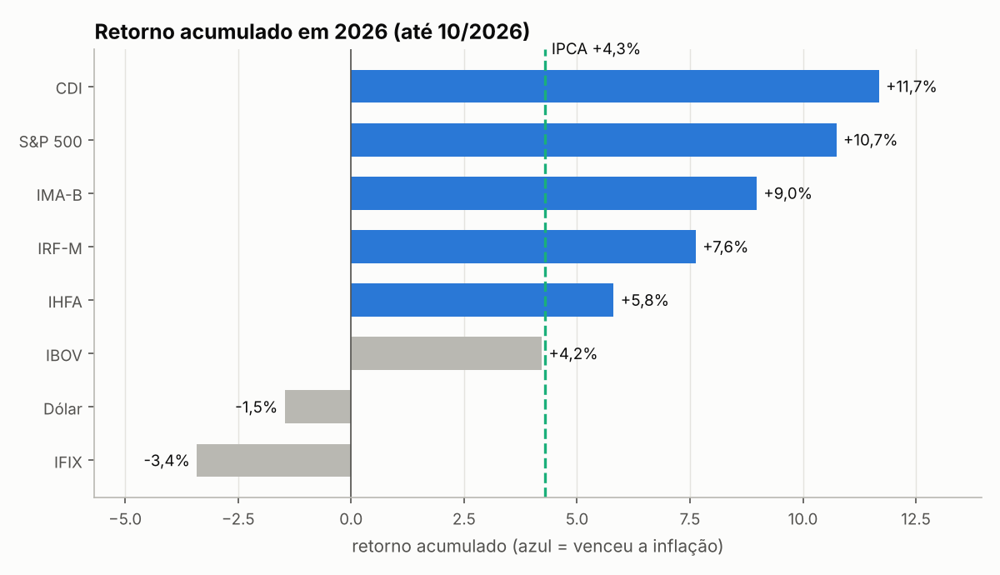
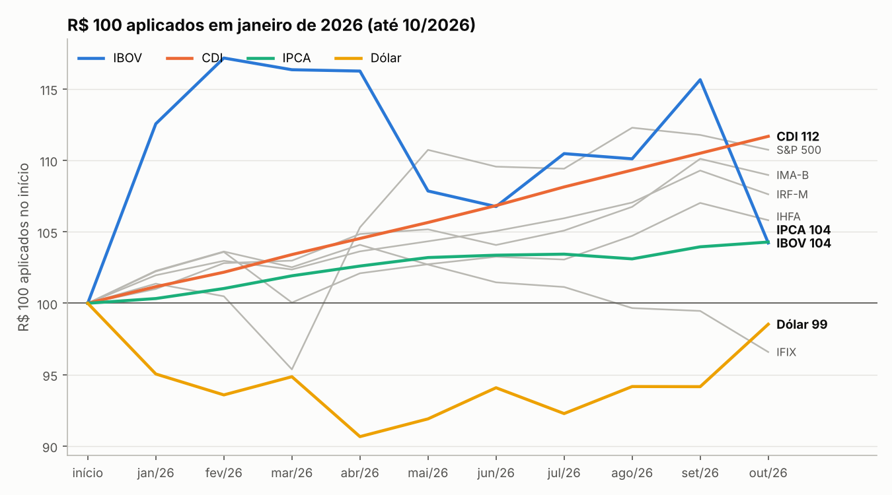
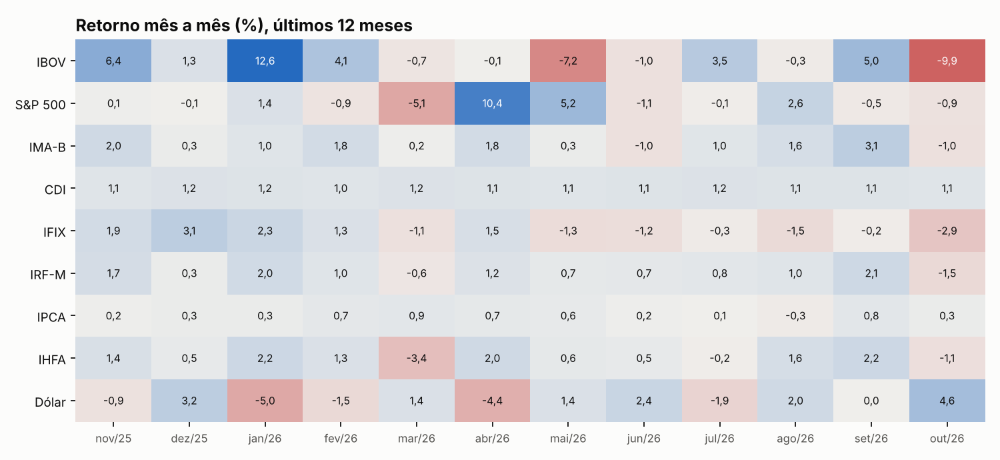

# Índices de mercado 2026: quem venceu a inflação?

Análise de **retorno e risco** de 9 índices que representam as principais classes de ativos de um investidor brasileiro: renda fixa pós, pré e inflação, ações Brasil e EUA, fundos imobiliários, multimercados, dólar e a própria inflação.



## Principais leituras (jan–out/2026)

- **CDI rendeu 11,7% no ano**, quase 7 pontos acima da inflação (4,3%), e foi o melhor resultado com a menor volatilidade.
- **Ações Brasil (IBOV) ficaram ligeiramente abaixo da inflação no ano**, depois de um começo forte: a maior queda em 12 meses chegou a 11%.
- Só **CDI, S&P 500 e IMA-B** bateram a meta de longo prazo **IPCA + 4% ao ano** (7,75% no período).
- O **dólar caiu** no ano e tem **correlação negativa** com quase todas as outras classes, o que o torna útil para diversificar.

> O IPCA de out/26 é a prévia (IPCA-15) até o IBGE divulgar o índice cheio; o pipeline marca esses valores como preliminares.

## O que o projeto faz

| Etapa | Onde | Destaque |
|---|---|---|
| Coleta | `src/indices/coleta.py` | API pública do Banco Central (SGS) para CDI, IPCA e dólar, por cima de uma base mensal versionada; registra divergências e cai para a base se a API estiver fora |
| Transformação | `coleta.py` | CDI diário encadeado para o mês; dólar diário convertido em variação de fim de mês |
| Métricas | `src/indices/metricas.py` | acumulado composto, retorno real, volatilidade anualizada, Sharpe frente ao CDI, maior queda (drawdown), meta IPCA + X% |
| Visualização | `src/indices/graficos.py` | evolução de R$ 100, ranking frente à inflação, mapa de calor mensal |
| Análise | `notebooks/analise.ipynb` | passo a passo com tabelas, correlação e limitações |
| Testes | `tests/` | composição de retornos, retorno real, drawdown, encadeamento do CDI |

## Conceitos aplicados

- **Retornos se compõem, não se somam.** `(1 + r1) × (1 + r2) × … − 1`. Somar 1% + 1% dá 2%; o correto é 2,01%.
- **Retorno real** = `(1 + nominal) / (1 + inflação) − 1`. Subtrair a inflação do retorno é só uma aproximação.
- **Volatilidade anualizada** = desvio-padrão mensal × √12.
- **Sharpe** = excesso médio sobre o CDI ÷ desvio do excesso × √12: quanto retorno extra por unidade de risco.
- **Drawdown** = maior queda de um pico até um vale, a métrica de risco que o investidor de fato sente.





## Como rodar

```bash
git clone https://github.com/mlsantos92/indices-mercado-2026
cd indices-mercado-2026
python -m venv .venv && source .venv/bin/activate   # Windows: .venv\Scripts\activate
pip install -r requirements.txt
pip install -e .

python -m indices.pipeline            # baixa CDI, IPCA e dólar do BCB e gera outputs/
python -m indices.pipeline --offline  # só com a base do repositório
pytest
```

## Fontes

- **Banco Central do Brasil, SGS** (API pública, sem cadastro): série 12 (CDI diário), 433 (IPCA mensal) e 1 (dólar comercial, venda).
- **Base mensal** (`data/raw/indices_mensal_base.csv`): retornos de IBOV, S&P 500, IMA-B, IRF-M, IFIX e IHFA compilados de relatório mensal de mercado.

## Limitações

- Com 12 meses, volatilidade, Sharpe e correlação são estimativas instáveis: servem para comparar, não para prever.
- A base não informa se o S&P 500 está em dólar ou em reais.
- Retornos de índices não descontam custos, impostos nem taxas de produtos reais.
- Análise descritiva, não recomendação de investimento.

## Próximos passos

- Buscar também IBOV e IFIX de fonte pública automatizada.
- Carteiras modelo (conservadora, moderada, arrojada) com rebalanceamento e comparação com a meta IPCA + X%.

## Sobre o uso de IA

Desenvolvido com IA como copiloto de código. A escolha das métricas, as regras financeiras (composição, retorno real, meta IPCA + X%), a validação contra a fonte oficial e a leitura dos resultados são minhas.
