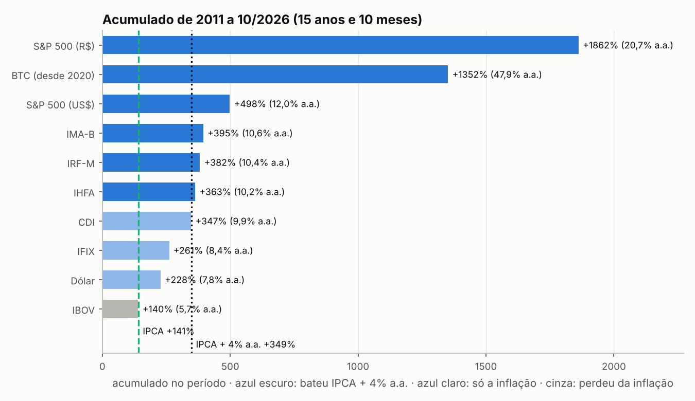
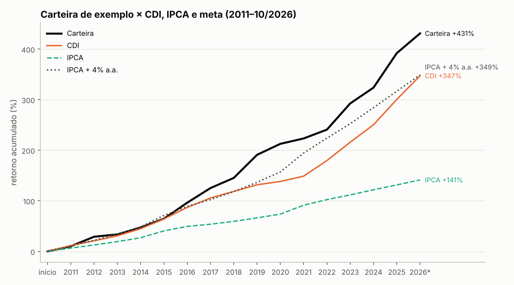
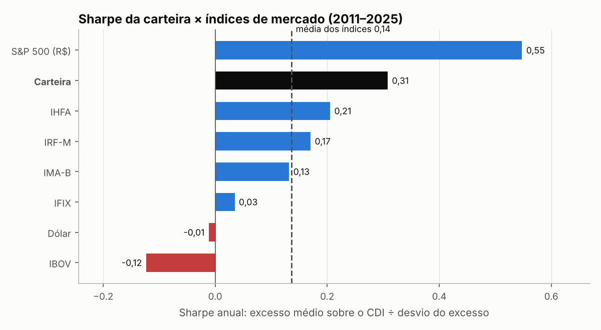

# Índices de mercado: quem venceu a inflação, em 2026 e em 15 anos?

Análise de **retorno e risco** de 10 índices que representam as principais classes de ativos de um investidor brasileiro: renda fixa pós, pré e inflação, ações Brasil e EUA, fundos imobiliários, multimercados, dólar, Bitcoin e a própria inflação. O S&P 500 aparece **em dólar e em reais**. Por cima dos índices, uma **carteira teórica** com taxa do cliente, aportes anuais e Sharpe comparado ao mercado.



## Principais leituras

**Em 2026 (jan–out):**
- **CDI rendeu 11,7%**, quase 7 pontos acima da inflação (4,3%), com a menor volatilidade.
- **S&P 500 subiu 10,7% em dólar, mas 9,1% em reais**: a queda do dólar no ano comeu parte do ganho de quem investe a partir do Brasil.
- **Ações Brasil (IBOV) ficaram ligeiramente abaixo da inflação**, e o **Bitcoin caiu 12,6%** em reais.

**Em 15 anos (2011 a out/2026):**
- O IPCA acumulou **141%**. A meta de longo prazo **IPCA + 4% a.a.** pedia **349%**.
- **S&P 500 em reais (+1.862%)** foi de longe o melhor. Em dólar, o mesmo índice rendeu +498%: o câmbio multiplicou o resultado, porque US$ 1 virou US$ 6,0 enquanto R$ 1 virou R$ 19,6.
- **IMA-B, IRF-M e IHFA** bateram a meta. O **CDI (+347%)** ficou praticamente nela, com a menor oscilação de todos.
- O **IBOV (+140%)** empatou com a inflação: 15 anos de bolsa brasileira sem ganho real.

**Carteira de exemplo** (35% CDI, 20% IMA-B, 10% IRF-M, 5% IHFA, 10% IBOV, 10% S&P 500 em reais, 10% IFIX, rebalanceada todo ano): **+431%** no período, ou **IPCA + 5,1% a.a.**, acima da meta e do CDI. Sharpe de **0,31**, contra **0,14** na média dos índices; ela fica acima de 6 dos 7 índices comparáveis.





> O IPCA de out/26 é a prévia (IPCA-15) até o IBGE divulgar o índice cheio; o pipeline marca esses valores como preliminares.

## O que o projeto faz

| Etapa | Onde | Destaque |
|---|---|---|
| Coleta | `src/indices/coleta.py` | API pública do Banco Central (SGS) para CDI, IPCA e dólar, por cima de uma base mensal versionada; registra divergências e cai para a base se a API estiver fora. Deriva o S&P 500 em reais |
| Histórico | `src/indices/historico.py` | retornos anuais de 2011 a 2025 + 2026 composto dos meses; acumulado e "ao ano" por período; tabela periódica |
| Métricas | `src/indices/metricas.py` | acumulado composto, retorno real, volatilidade, Sharpe frente ao CDI, maior queda (drawdown), meta IPCA + X% |
| Carteira | `src/indices/carteira.py` | rebalanceamento anual, taxa do cliente na renda fixa, risco do prefixado com marcação a mercado, Sharpe × índices, aportes anuais, resultado em reais |
| Visualização | `src/indices/graficos.py` | acumulado no período, carteira × referências, Sharpe comparado, evolução no ano, mapa mensal |
| Análise | `notebooks/analise.ipynb` | passo a passo com tabelas, correlação e limitações |
| Testes | `tests/` | composição, retorno real, drawdown, CDI diário, S&P em reais, ano parcial, carteira, marcação a mercado, aportes |

## Conceitos aplicados

- **Retornos se compõem, não se somam.** `(1 + r1) × (1 + r2) × … − 1`. Somar 1% + 1% dá 2%; o correto é 2,01%.
- **Retorno real** = `(1 + nominal) / (1 + inflação) − 1`. Subtrair a inflação do retorno é só uma aproximação.
- **Ativo em dólar para quem investe em reais** = `(1 + retorno em US$) × (1 + variação do dólar) − 1`.
- **Volatilidade** = desvio-padrão dos retornos (mensal × √12, ou anual direto no histórico).
- **Sharpe** = excesso médio sobre o CDI ÷ desvio do excesso. Sozinho diz pouco: aqui ele é **comparado com o Sharpe de cada índice nos mesmos anos**.
- **Marcação a mercado do prefixado.** Com taxa prefixada contratada, a RF Pré rende a taxa todo ano e parece não oscilar. Mas quem vende antes do vencimento recebe o preço de mercado. No risco, a oscilação usada é a do IRF-M no período. Numa carteira 70% CDI e 30% prefixado a 12%, a volatilidade sobe de 2,5% para 4,0% ao ano, sem mudar o retorno médio.
- **Drawdown** = maior queda de um pico até um vale, a métrica de risco que o investidor de fato sente.

## Como rodar

```bash
git clone https://github.com/mlsantos92/indices-mercado-2026
cd indices-mercado-2026
python -m venv .venv && source .venv/bin/activate   # Windows: .venv\Scripts\activate
pip install -r requirements.txt
pip install -e .

python -m indices.pipeline            # baixa CDI, IPCA e dólar do BCB e gera outputs/
python -m indices.pipeline --offline  # só com a base do repositório
pytest
```

Carteira pela linha de comando:

```bash
python -m indices.carteira    # carteira de exemplo, 2011–2026
python -m indices.carteira --pesos "CDI=60,IMA-B=40" --taxa-cdi 110 --ipca-mais 6 --inicio 2016
python -m indices.carteira --pesos "CDI=70,IRF-M=30" --pre 12 --aporte-inicial 50000 --aporte-anual 12000
python -m indices.carteira --pesos "CDI=90,BTC=10" --valor-hoje 200000
```

Índices aceitos: `CDI`, `IMA-B`, `IRF-M`, `IHFA`, `IBOV`, `S&P 500 (US$)`, `S&P 500 (R$)`, `IFIX`, `Dólar`, `BTC`.

## Fontes

- **Banco Central do Brasil, SGS** (API pública, sem cadastro): série 12 (CDI diário), 433 (IPCA mensal) e 1 (dólar comercial, venda).
- **Base mensal** (`data/raw/indices_mensal_base.csv`, nov/25 a out/26): IBOV, S&P 500, IMA-B, IRF-M, IFIX, IHFA e Bitcoin pela [Mais Retorno](https://maisretorno.com); IPCA do IBGE.
- **Base anual** (`data/raw/indices_anual.csv`, 2011 a 2025): tabela "15 anos" da [Meu Patrimônio](https://meupatrimonio.com) (31/12/2025). Bitcoin de 2020 a 2025 pela Mais Retorno ([MarketVector Bitcoin Benchmark Rate](https://maisretorno.com/indice/bbr)), em dólar, convertido para reais.
- **S&P 500** é o índice **em dólar** (price return, sem dividendos). A versão em reais é derivada com o dólar da mesma base.

## Limitações

- Com 12 meses, volatilidade, Sharpe e correlação são estimativas instáveis: servem para comparar, não para prever.
- No histórico, o Sharpe usa um retorno por ano. Com poucos anos (5 completos = 5 observações), é uma régua de comparação, não uma medida estatisticamente firme.
- O Bitcoin só tem dados de 2020 em diante: com ele na carteira, o estudo começa em 2020.
- Retornos de índices não descontam custos, impostos nem taxas de produtos reais.
- Análise descritiva, não recomendação de investimento.

## Próximos passos

- Buscar também IBOV, IFIX e IMA-B de fonte pública automatizada.
- Carteiras modelo (conservadora, moderada, arrojada) lado a lado.

## Sobre o uso de IA

Desenvolvido com IA como copiloto de código. A escolha das métricas, as regras financeiras (composição, retorno real, conversão cambial, meta IPCA + X%, marcação a mercado do prefixado, rebalanceamento), a validação contra as fontes e a leitura dos resultados são minhas.
